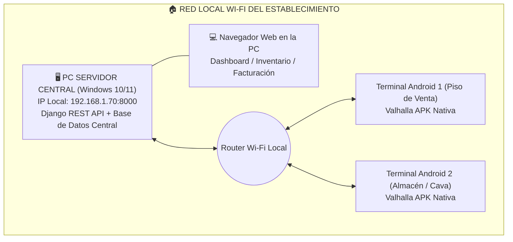
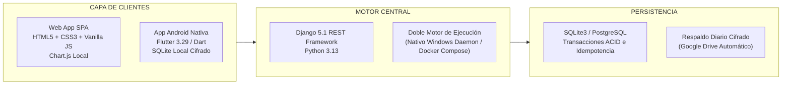

#  VALHALLA — Sistema Inteligente de Inventario y Ventas

<p align="center">
  
  
  
  
  
  
</p>

---

##  Visión General del Proyecto

**Valhalla** es una plataforma integral de gestión de inventarios, formulación de recetas, control de producción y terminal de punto de venta (POS) multi-producto, diseñada a la medida para destilerías artesanales, embotelladoras y comercios especializados.

El sistema resuelve la complejidad del negocio mediante un modelo de **doble inventario**:
1. **Inventario Central de Materias Primas:** Control exacto de insumos en granel (alcoholes, destilados y esencias en litros con precisión decimal; botellas de vidrio, corchos y etiquetas en piezas enteras).
2. **Subinventario de Producto Terminado:** Gestión de botellas listas para su comercialización, cuyo stock se genera mediante un proceso de **embotellado dinámico** que descuenta automáticamente los insumos exactos del inventario central según la receta configurada.

---

##  Filosofía: Minimalismo Técnico y Soberanía Total

En un mercado saturado de software de suscripción costoso y configuraciones en la nube difíciles de mantener, **Valhalla** fue concebido bajo dos principios rectores:

### 1. Minimalismo Técnico para el Usuario Final
* **Cero comandos de consola:** El usuario no requiere conocimientos técnicos ni lidiar con terminales. El sistema se instala, inicia y detiene con scripts de automatización de 1 clic (`.bat`).
* **Cero dependencias pesadas en producción:** La interfaz web de escritorio es una Single Page Application (SPA) ultraligera en HTML5/Vanilla JS y CSS nativo que no requiere Node.js, Webpack ni transpiladores para funcionar.
* **Experiencia de usuario fluida:** Interfaz visual unificada con la paleta de identidad corporativa en 5 tonos institucionales:
  - `Sapphire Blue (#3D71A3)` — Acentos activos, indicadores y navegación.
  - `Royal Indigo (#2F3D82)` — Acciones principales, totales y confirmaciones.
  - `Deep Violet (#2C2863)` — Encabezados estructurales y tarjetas.
  - `Dark Eggplant (#321950)` — Gradientes institucionales y series de datos.
  - `Night Purple (#2E0A32)` — Fondo profundo y contraste de alta visibilidad.

### 2. Costo \$0.00 MXN en Infraestructura y Hosting
* **Sin servidores en la nube pública:** No pagas mensualidades en AWS, Google Cloud, Heroku ni Firebase.
* **Privacidad Absoluta:** Toda la información contable, recetas y ventas reside exclusivamente dentro de las computadoras del negocio, garantizando confidencialidad industrial.

---

##  Conexión en Red Local (LAN) y Operación Offline

El sistema opera sobre la red Wi-Fi o cableada local del establecimiento, permitiendo que la computadora principal actúe como **Servidor Central Seguro** sin exponer puertos a internet.

### Arquitectura de Conexión LAN



### ¿Cómo funciona la conexión sin pagar hosting?
1. **Arranque en la PC Principal:** Al ejecutar `iniciar_servidor.bat`, el motor de Valhalla arranca en el puerto `8000` y detecta la dirección IP local asignada por el módem del negocio (ej. `192.168.1.70`).
2. **Acceso Inmediato en Piso:** Cualquier teléfono celular, tablet o laptop conectada a la misma red Wi-Fi puede acceder instantáneamente escribiendo `http://192.168.1.70:8000/` en el navegador o abriendo la aplicación móvil nativa.
3. **Resiliencia Offline-First (Modo Outbox SQLite):**
   - Si el vendedor baja al sótano, ingresa a la bodega o realiza una entrega fuera del alcance de la red Wi-Fi, la aplicación **Android sigue funcionando al 100%**.
   - Las ventas se guardan de forma segura y cifrada en la base de datos local SQLite del teléfono con estado `PENDING`.
   - En cuanto el dispositivo vuelve a detectar la red Wi-Fi, la app sincroniza las ventas pendientes en segundo plano mediante peticiones con cabeceras `Idempotency-Key`, evitando duplicidad de folios y descontando el stock central en tiempo real.

---

## ⚙️ Opciones y Modos de Uso para el Usuario

El ecosistema Valhalla ofrece dos modos de interacción perfectamente sincronizados:

### 🖥️ Modo Servidor / Escritorio (PC Host)
* **Tablero de Control y Analítica:** Resumen financiero en tiempo real, KPIs de facturación bruta, IVA trasladado y desglose de botellas vendidas.
* **Modelo Matemático de Tendencias:** Motor de proyección comercial con regresión de pendiente ($m$) y coeficiente de determinación $R^2$ para identificar productos en aceleración.
* **Gestión de Materias Primas:** Registro de insumos en litros o piezas, costos promedio ponderados y actualización de existencias por compras o mermas.
* **Recetario Dinámico y Embotellado:** Configuración visual de qué ingredientes consume cada botella. Con un clic en *"Embotellar"*, el sistema verifica disponibilidad y descuenta del almacén central.
* **Punto de Venta Mostrador:** Carrito multi-producto con cálculo exacto de impuestos según la **fórmula fiscal 16/116**:
  $$\text{Base Gravable} = \frac{\text{Precio Final}}{1.16}, \quad \text{IVA (16\%)} = \text{Precio Final} \times \left(\frac{16}{116}\right)$$
* **Recepción de Ventas Móviles:** Bandeja de entrada para auditar, surtir o aceptar ventas reportadas por los operadores de piso.

### 📱 Modo Móvil / Vendedor de Piso (APK Android)
* **Arranque Directo:** Ingresa de inmediato al catálogo de productos terminados listos para cobrar.
* **Carrito y Ventas Rápidas:** Agregar productos con cantidades y descuentos con un toque.
* **Operación Sin Conexión:** Venta en bodega o mostrador sin depender de internet.
* **Ajuste de Conexión:** Menú de configuración accesible mediante el icono de engranaje para ingresar o cambiar la IP del servidor central.

---

##  Especificaciones Técnicas y Stack de Desarrollo



| Componente | Tecnología | Detalle Técnico |
| :--- | :--- | :--- |
| **Backend API** | Python 3.13 / Django 5.1 REST | API RESTful con soporte CSRF, rate-limiting, paginación y cabeceras de idempotencia |
| **Motor de Ejecución** | Dual: Nativo Windows & Docker | Arranque en segundo plano mediante `python manage.py runserver` o contenedor `Dockerfile` |
| **Base de Datos** | SQLite 3 / PostgreSQL | Esquema relacional con integridad referencial, inventarios transaccionales y auditoría |
| **Cliente Web Escritorio** | SPA Híbrida (Vanilla JS / CSS3) | Single Page Application sin dependencias externas, estilizada con la paleta de 5 colores |
| **Cliente Móvil** | Flutter 3.29.0 / Dart 3.7.0 | Aplicación para Android con patrón Outbox SQLite y sincronización bidireccional |
| **Pruebas Automatizadas** | Flutter Test / Django Test | **31 pruebas unitarias y de widgets** en verde con 100% de éxito |

---

## 🚀 Guía de Despliegue en 3 Pasos (Para la PC Servidor)

No se requiere instalar entornos de desarrollo complejos. En la PC que servirá como servidor principal:

### Paso 1: Clonar el Repositorio
```bash
git clone https://github.com/<tu-usuario>/valhalla.git
cd valhalla
```

### Paso 2: Ejecutar el Instalador Automatizado
Haz doble clic sobre el archivo:
**`instalar_servidor.bat`**
*El asistente creará la regla en el Firewall de Windows Defender para el puerto 8000 y configurará la base de datos automáticamente.*

### Paso 3: Iniciar el Sistema
Haz doble clic sobre:
 **`iniciar_servidor.bat`**
*El sistema abrirá tu navegador automáticamente en `http://127.0.0.1:8000/` y te mostrará la dirección IP para conectar tus celulares.*

####  Credenciales por Defecto:
* **Usuario:** `admin`
* **Contraseña:** `Admin-password-123!`

---

##  Instalación de la Aplicación Móvil en Android

Para instalar la aplicación en los teléfonos de tu equipo de ventas:
1. Ve a la sección de [Releases de este repositorio](https://github.com) y descarga el archivo:
    **`valhalla-movil.apk`**
2. Pásalo a tu teléfono Android o descárgalo directamente desde el navegador del celular.
3. Pulsa sobre el archivo descargado y selecciona **Instalar** (permite la instalación de aplicaciones de origen desconocido si el sistema te lo solicita).
4. Abre la app, pulsa el engranaje superior derecho e introduce la IP de tu PC Servidor (ej. `http://192.168.1.70:8000`). ¡Listo para vender!

---

##  Scripts de Automatización Incluidos

En la raíz del proyecto encontrarás los siguientes accesos directos:

* 🟢 **`iniciar_servidor.bat`:** Inicia el servidor central en segundo plano y abre la interfaz web.
* 🔴 **`detener_servidor.bat`:** Cierra limpiamente todos los procesos de Valhalla en el puerto 8000.
* ⚙️ **`instalar_servidor.bat`:** Ejecuta migraciones y abre el firewall local con permisos de Administrador.
* 🔄 **`configurar_autoarranque.bat`:** Registra el servidor para que arranque solo cada vez que se enciende la PC.

---

##  Licencia

Este proyecto está distribuido bajo la licencia **MIT**. Consulta el archivo `LICENSE` para más detalles.

---

<p align="center">
  <b>Valhalla — Software de Gestión y Control Comercial</b><br/>
  <i>Desarrollado con arquitectura local segura, alto rendimiento y costo cero en la nube.</i>
</p>
