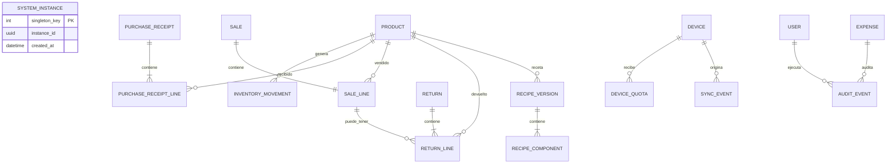

# Modelo de datos

## Principios

- PostgreSQL local en Windows es la fuente de verdad central. Cada Android conserva su estado operativo offline y outbox en SQLite cifrado hasta recibir ACK; no se presume sincronizado antes de ello.
- Conservar documentos y movimientos históricos; no borrar ventas o entradas para corregirlas. Usar cancelaciones o ajustes auditables.
- Guardar cantidades y dinero con precisión decimal apropiada, no coma flotante binaria.
- Guardar fecha de operación y fecha de creación del registro; interpretar periodos del negocio en la zona fija UTC-06:00 todo el año.
- Cada evento tiene UUID, dispositivo y secuencia creciente para idempotencia y orden; el servidor conserva el resultado terminal (incluido rechazo) y su ACK para contestar reintentos sin repetir movimientos.

## Entidades propuestas

### `Product`

- `id`, `name`, `sku` opcional, `description` opcional.
- `product_type`, `base_unit`, `precision`, `active`, `created_at`, `updated_at`.
- Unidad y conversión quedan fijas desde el primer movimiento. Precio vigente tiene versiones; cada partida congela precio y receta.
- Para Valhalla y Valhalla Mini no se mantiene existencia de producto terminado: el surtido consume líquido y el envase según las cantidades acordadas.

### `InventoryMovement`

- `id`, `component_id`, `movement_type`, `quantity_delta` en unidad base, `unit_cost`/costo original cuando aplique.
- `occurred_at`, `received_at`, `created_at`, `reason`, `reference_type`, `reference_id`, `created_by`, `device_id`, `event_id`.
- Tipos: saldo inicial oficial, entrada, consumo por venta, reingreso por devolución y ajuste.
- El saldo se obtiene de movimientos confirmados; una proyección/caché no reemplaza el historial.
- Los movimientos de apertura aún no conciliados se identifican como provisionales, se excluyen del saldo oficial y solo aparecen en vistas claramente rotuladas como provisionales.

### `PurchaseReceipt` y `PurchaseReceiptLine`

Representan entradas recibidas y sus partidas: producto, cantidad, unidad, costo unitario, fecha y referencia. La entrada afecta existencias y promedio ponderado al confirmarse.

### `Sale` y `SaleLine`

Representan una venta independiente por producto, fecha de solicitud/surtido y estado. Una pendiente es local al dispositivo, no reserva stock ni se sincroniza/reportea hasta surtirla. Cada venta tiene una partida de producto que congela versión de receta, cantidad, precio/descuento, importe final, impuesto y costo aplicados. No hay ticket conjunto.

### `Return` y `ReturnLine`

Vinculadas a venta/dispositivo original. Guardan cantidad, reembolso, impuesto revertido, fecha real y estado. Exigen recepción completa de todos los componentes controlados de la receta congelada; reingresan con costos originales y cuotas si son offline. Reembolso acumulado no supera el pago original.

### `Expense`

Gasto general con nombre, importe MXN, fecha, tipo único o plantilla recurrente mensual/anual, vigencia y estado. Sin asignación ni prorrateo por producto; cambios a ocurrencias históricas quedan auditados.

### `TaxConfiguration`

Parámetro de negocio aprobado: impuesto incluido de 16%, desglosado como `importe_final × 16 / 116`. No representa cálculo fiscal. La ganancia posterior al factor es 84% de la ganancia después de costos y gastos.

### `User` / `AuditEvent`

Identidad, permisos, acciones y cambios relevantes, sujetos a la solución de autenticación. No almacenar tokens de GitHub como credenciales de los usuarios de la aplicación.

### `SystemInstance`

Una fila singleton (`singleton_key = 1`) en PostgreSQL conserva el UUID estable de la instalación. Se crea una sola vez por base nueva y viaja con el respaldo/restauración; la API lo devuelve como `instance_id`. La comprobación de salud requiere que PostgreSQL esté disponible.

### `Device`, `DeviceQuota` y `SyncEvent`

`Device` conserva identidad, identificador/estado de su credencial exclusiva, certificado fijado, estado activo/revocado y última secuencia. La clave ECDSA P-256/SHA-256 se protege en Android Keystore y no expira automáticamente; el servidor conserva la clave pública en SPKI DER/Base64URL sin padding, y `key_id` es SHA-256 de esos bytes en Base64URL sin padding. Su revocación/reemplazo requiere decisión administrativa y nuevo emparejamiento. Las solicitudes firman una representación UTF-8 de campos en orden fijo, con firma DER/Base64URL sin padding; las rutas firmadas usan segmentos ASCII/UUID y query vacía. La recuperación de emparejamiento usa `pairing_request_id` con el mismo QR y clave pública para reproducir un alta ya persistida. `DeviceQuota` asigna cantidades por componente; Windows vende solo del stock central no asignado mediante API. `SyncEvent` guarda UUID, secuencia, payload/versiones, estado (recibido, aplicado, conflicto, rechazado), respuesta/ACK y auditoría. El Android mantiene su outbox SQLite persistente hasta ACK; Windows no tiene outbox.

### `LocalStore`

En Android, SQLite cifrado mantiene catálogo/costos/cuotas sincronizados, ventas pendientes locales, saldos de cuota, eventos outbox y estados de sincronización. Una operación offline no cambia el servidor ni se presenta como sincronizada.

El cliente Windows mantiene una caché SQLite cifrada de solo lectura para datos consultados. PostgreSQL sigue siendo la única autoridad; cualquier escritura de Windows requiere la API y no se encola para operación offline.

La clave de SQLite Android se genera localmente durante instalación/alta, es aleatoria, no exportable, no respaldada y protegida en Android Keystore; perderla puede hacer irrecuperable la outbox y requiere reemparejar. La rotación se realiza por acción administrativa ante reemplazo o compromiso. La clave de caché Windows se protege con DPAPI del usuario de la aplicación; si no puede descifrarse, se muestra error y se reconstruye desde PostgreSQL cuando esté disponible.

### `RecipeVersion` y `RecipeComponent`

La versión activa fija producto, componentes, cantidades/unidades y fecha de vigencia. El surtido y la devolución referencian la versión congelada en la venta; una receta con movimientos no se edita retroactivamente.

## Relaciones principales

El diagrama es conceptual: una implementación puede normalizar eventos, cuotas y snapshots manteniendo las reglas de `09-pseudocodigo.md`.

## Configuración de despliegue pendiente

- Fecha efectiva de arranque, versión GA de Windows 11 aún soportada al desplegar (PC con edición Home) y política de limpieza local después de verificar respaldos subidos.
- Compilación mínima de Windows 11.
- Unidades/conversiones y costos verificados de componentes que se agreguen al catálogo.
- Versiones mínimas de Android/Windows y política para actualización de clientes/protocolo.

No se introducen múltiples monedas, almacenes, lotes, caducidades ni datos de clientes en el alcance aprobado. Los algoritmos y límites del modelo se rigen por `09-pseudocodigo.md`.
