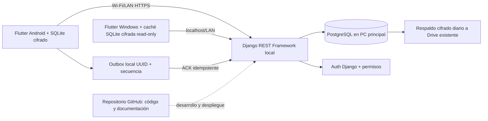

# Arquitectura y decisiones

## Arquitectura objetivo

Windows principal aloja la API y base de datos en LAN; Android conserva SQLite cifrado, cuotas y outbox para operación offline. El cliente Windows mantiene una caché SQLite cifrada de solo lectura; todas sus escrituras requieren API/PostgreSQL y no tiene outbox offline. GitHub solo aloja código/documentación. Google Drive se usa únicamente para respaldos y no es una dependencia para operar.

## Decisiones ya acordadas

| Tema | Decisión |
|---|---|
| Clientes | Flutter/Dart para Android y Windows |
| Instalador | Windows mediante paquete MSI construido con WiX Toolset; la aplicación puede reemplazarse sin ubicar los datos PostgreSQL en su directorio |
| Firewall | Solo proceso/API TCP 8443 permitido en perfil privado y LAN; PostgreSQL solo local y no expuesto a clientes ni Internet |
| Actualizaciones | Ventana planificada con aviso previo; detener escrituras durante migración y conservar outbox Android hasta volver a compatibilidad |
| Versiones mínimas | Android 12 (API 31) y la última versión GA de Windows 11 con soporte vigente al desplegar; PC con edición Home. Referencia al 9 de noviembre de 2026: Windows 11 26H2; revalidar soporte antes del despliegue |
| Versionado API | `/api/v1` admite cambios aditivos compatibles; un cambio incompatible requiere una ruta mayor nueva. Una versión incompatible se informa explícitamente y no descarta eventos pendientes Android |
| Contrato y errores API | OpenAPI; paginación por cursor en listados cuando aplique; error común `code`, `message`, `request_id`, `retryable`, `details`; no confirmar escrituras parciales; toda escritura Windows usa `Idempotency-Key` UUID |
| Salud e identidad de instancia | `GET /health` valida API y PostgreSQL; si PostgreSQL no responde, devuelve `503 SERVICE_UNAVAILABLE`. `instance_id` es un UUID singleton persistido en PostgreSQL y conservado en backup/restore |
| Autenticación administrativa API | Django Auth con cookie `Secure`, `HttpOnly`, `SameSite=Strict` y CSRF; 30 min de inactividad o 8 h máximo; cliente protege cookie con DPAPI de usuario Windows y no persiste contraseña |
| Aprovisionamiento inicial de usuarios | `createsuperuser` crea ADMIN; la pertenencia al grupo Django `OPERADOR` asigna ese rol. Sin rutas de gestión de usuarios en este alcance; el aprovisionamiento inicial se hace localmente por comandos Django |
| Compatibilidad de clientes | Aceptar versión actual y anterior de Android durante 12 meses desde cada publicación; después exigir actualización para sincronizar. Avisar en la app; incompatibilidad bloquea solo la sincronización incompatible y conserva la outbox |
| Rendimiento objetivo | Hasta 3 dispositivos Android; hasta 5,000 eventos pendientes por dispositivo; p95 de solicitudes API interactivas ≤2 s y un lote de 1,000 eventos por dispositivo ≤60 s medido individualmente por LAN. Medir en PC con al menos 4 núcleos, 16 GB RAM y SSD |
| Backend | Python + Django REST Framework |
| Base de datos | PostgreSQL local en la PC Windows principal; SQLite cifrado operativo/outbox en Android y caché read-only en Windows |
| Conectividad | Solo Wi-Fi/LAN; no exponer a internet ni contratar servicios |
| Ejecución | La PC sirve mientras la app Windows está abierta. Android sincroniza al abrir/volver a primer plano con Wi-Fi y servidor disponible; no hay servicio Android en segundo plano |
| Seguridad de LAN | IP reservada; TLS local con huella de certificado emparejada por QR de un solo uso |
| Autorización | ADMIN administra catálogo/recetas/precios, dispositivos/cuotas, costos faltantes, ajustes, importaciones/correcciones, restauraciones, conflictos y plantillas recurrentes de gastos; OPERADOR registra entradas, ventas, devoluciones y gastos únicos dentro de límites aprobados |
| Alta de producto | Crear inactivo; ADMIN agrega versión inicial de receta y precio en pasos separados. Se activa automáticamente cuando ambos existen; cambios de versión posteriores no lo desactivan |
| Persistencia offline | Android usa outbox UUID/secuencia, idempotencia y retención hasta ACK; conflicto detiene la cola del dispositivo. Windows no tiene outbox |
| Inventario offline | Cuotas por componente para Android; Windows vende del stock central no asignado; entradas no asignan cuota automáticamente |
| Respaldo | Dump cifrado diario a las 22:00 UTC-06:00 mientras la app Windows está abierta; Drive existente, retención remota 30 días; copia local pendiente hasta verificar carga y reintento en la siguiente ejecución diaria |
| Retención local | Tras verificar la nueva carga, conservar siempre el respaldo local válido más reciente y además las últimas 7 copias diarias. Alertar si espacio libre cae por debajo de 2× tamaño del último respaldo cifrado válido; no borrar copia previa ni promover backup incompleto. Antes del primer respaldo válido, estimar desde el tamaño actual de PostgreSQL y exigir espacio libre de al menos 2× esa estimación; si no alcanza, alertar y no borrar copias |
| Restauración | Prueba mensual en entorno aislado y también después de cambios importantes de instalación o esquema |
| Autorización de restauración | Crear solicitud ADMIN con advertencia de pérdida; exigir dos confirmaciones separadas de la misma cuenta ADMIN y sesión antes de ejecución controlada |
| GitHub | Repositorio de código/documentación y colaboración, no base de datos operativa |
| Costeo | Promedio ponderado móvil; ajustes positivos requieren costo unitario y negativos usan el promedio vigente |
| Ventas y devoluciones | Las ventas consumen receta congelada al surtirse; devoluciones completas reingresan componentes a costo original |
| Gastos | Gastos generales únicos o recurrentes mensuales/anuales; no se asignan/prorratean por producto |
| Periodos | Zona fija UTC-06:00 todo el año |
| Precio e impuesto | Precios incluyen impuesto del 16%, desglosado como `final × 16 / 116` |
| Ganancia posterior | Métrica interna: 84% de ventas netas con impuesto incluido menos costos y gastos |

## Configuración previa al despliegue

- Política para actualizar clientes/protocolo.
- Fecha efectiva de arranque y política de limpieza local de respaldos ya verificados.
- Unidad/conversión y costo de nuevos componentes; botellas y corchos iniciales se oficializan tras recuento y costeo.
- Puerto API concreto; certificado, huella, ACL y procedimiento de recuperación; IP reservada y nombres de dispositivos.

## Requisitos de sincronización y consistencia

- El servidor aplica eventos, movimientos, cuotas, secuencia y respuesta ACK en una transacción.
- El contrato `/api/v1` se documenta en OpenAPI. Los errores usan los campos acordados y distinguen fallas corregibles, autorización, validación, conflicto y fallas reintentables. No confirmar escrituras parciales; preservar eventos pendientes cuando haya incompatibilidad y bloquear solo la sincronización incompatible.
- Mantener la versión actual y la anterior de Android durante 12 meses desde cada publicación; después exigir actualización para sincronizar. Informar el cambio en la app antes de que la incompatibilidad bloquee la sincronización.
- El MSI de WiX instala la aplicación; PostgreSQL y sus datos quedan fuera del directorio reemplazable. El firewall permite únicamente el proceso/API en perfil privado y LAN; PostgreSQL escucha localmente.
- Las actualizaciones tienen ventana planificada y aviso a dispositivos. Antes de migrar se requiere respaldo verificado; detener escrituras, no servir con esquema parcial, usar migraciones hacia adelante/reanudables y no ejecutar downgrade destructivo automáticamente. Restaurar backup requiere autorización administrativa y advertencia de pérdida de operaciones posteriores al respaldo.
- Android genera UUID y secuencia creciente para su outbox; no elimina eventos hasta ACK y un UUID con resultado terminal (confirmado o rechazado) devuelve el resultado/ACK previamente persistido. Repetir una resolución con la misma decisión reproduce su ACK sin efectos; una decisión distinta no modifica el resultado terminal. Windows envía escrituras a la API y no mantiene outbox.
- Offline cada Android descuenta únicamente su cuota. Windows vende usando el stock central no asignado mediante la API; entradas confirmadas quedan no asignadas.
- La caché SQLite de Windows es de solo lectura; ninguna operación se confirma desde ella ni se conserva en una outbox Windows.
- Si API/PostgreSQL no está disponible, Windows permite lecturas desde una caché íntegra claramente marcada como potencialmente obsoleta; sin caché válida presenta error. Las escrituras siempre requieren API/PostgreSQL.
- Evento inválido/conflictivo conserva payload y pausa la cola; solo administrador lo resuelve con auditoría.
- Al aceptar un conflicto, el servidor aplica la operación, consume su secuencia y guarda el resultado/ACK en una transacción. Al rechazarlo, conserva el evento como no oficial, registra la decisión, consume su secuencia y emite un ACK terminal de rechazo. Ambos resultados y sus ACK se reproducen sin duplicar efectos al reintentar; el cliente conserva el payload/auditoría, lo retira de la cola activa solo al recibir el ACK y continúa con la siguiente secuencia.
- Ventas pendientes no reservan, no se sincronizan y no se reportan hasta surtir.
- Devolución reingresa todos los componentes y ajusta la cuota de origen si fue offline; reembolso acumulado no supera el pago original.
- Saldos iniciales provisionales se excluyen de stock/costos/reportes oficiales hasta conciliación física.
- Las gráficas y la tabla deben usar el mismo origen de datos y reglas de cálculo.

## Seguridad y datos

- Usar HTTPS local con certificado fijado; emparejamiento mediante QR de un solo uso.
- Dirección aprobada: cada Android usa una clave exclusiva ECDSA P-256/SHA-256 generada y protegida en Android Keystore; el servidor conserva la clave pública SPKI DER/Base64URL sin padding; `key_id` es SHA-256 de esos bytes en Base64URL sin padding. Cada solicitud firma versión de protocolo, instancia, `key_id`, método, ruta ASCII/UUID y query vacía, SHA-256 del cuerpo exacto, timestamp (tolerancia ±5 minutos) y nonce aleatorio de 128 bits (consumo atómico, retención 15 minutos). Los campos se codifican UTF-8 en orden fijo separados por LF; la firma ECDSA DER se transporta como Base64URL sin padding. Los endpoints de dispositivo no usan query; si requieren paginación, el cursor se transmite en la ruta. El QR incluye endpoint LAN, ID de instancia, huella TLS y token aleatorio de 256 bits; Windows conserva solo SHA-256 del token y lo consume atómicamente. Dura 5 minutos y es de un solo uso. El administrador inicia el alta en Windows y el primer escaneo válido completa el emparejamiento. La credencial no expira automáticamente; revocación/reemplazo requieren decisión administrativa. Un nuevo emparejamiento genera nueva clave; solo se conserva identidad/secuencia si el administrador confirma que es el mismo equipo. Un equipo perdido recibe identidad nueva. La huella TLS se verifica aparte y su renovación requiere nuevo emparejamiento QR. Si se pierde la respuesta de alta, el mismo `pairing_request_id`, QR y clave pública reproduce el resultado ya persistido; una combinación distinta falla y un QR vencido sin alta completada requiere generar uno nuevo.
- SQLite Android usa una clave aleatoria no exportable protegida en Android Keystore, generada localmente durante la instalación/alta y no exportada ni respaldada; la pérdida puede hacer irrecuperable la outbox y exige reemparejar. La rotación se realiza por decisión administrativa ante reemplazo o compromiso. La caché SQLite Windows usa clave protegida con DPAPI del usuario de la aplicación; si no descifra, falla con error y se reconstruye desde PostgreSQL cuando esté disponible. La clave privada TLS se guarda en el almacén de certificados Windows con ACL restringida a la aplicación. La contraseña/clave del backup se guarda en un gestor externo bajo custodia del administrador y de un segundo custodio, que deberá designarse antes de activar respaldos y verificar recuperación aislada. Si se pierde la respuesta de alta, el mismo `pairing_request_id`, QR y clave pública reproduce el resultado ya persistido; una combinación distinta falla y un QR vencido sin alta completada requiere generar uno nuevo.
- Administrador se autentica en Windows con Django Auth; dispositivo se autentica con su credencial propia. Operador Android es seleccionable offline, identidad declarativa.
- Mantener secretos fuera del repositorio y proteger credenciales locales.
- Ejecutar la tarea diaria de respaldo solo mientras la aplicación Windows esté abierta; si se pierde la hora programada, dejarla pendiente hasta el siguiente inicio de la aplicación.
- Si Drive no está disponible, conservar la copia cifrada local, reintentar en la siguiente ejecución diaria y no eliminarla antes de verificar la carga; aplicar después la política configurada de limpieza local.
- Tras verificar la carga, conservar localmente el respaldo válido más reciente y las últimas 7 copias diarias. Alertar si el espacio libre es menor a 2× el tamaño del último respaldo cifrado válido; no eliminar la copia previa ni promover una incompleta. Si aún no existe respaldo válido, estimar desde el tamaño actual de PostgreSQL y exigir espacio libre de al menos 2× esa estimación; si no alcanza, alertar y no borrar copias.
- Declarar restauración válida solo después de restaurar en PostgreSQL aislado, validar esquema e integridad y cotejar conteos/saldos/eventos/auditoría contra el manifiesto del respaldo. Probar mensualmente y después de cambios importantes de instalación/esquema.
- RPO/RTO quedan pendientes y no son garantías del diseño actual.
- No usar un token personal de GitHub para que los clientes accedan a la API o base de datos.
- Registrar actor seleccionado, dispositivo, fechas de operación/recepción, cambios, resolución y motivo.
- El repositorio público/privado y el flujo de CI/CD se decidirán aparte; los datos reales del negocio no deben incluirse en commits.
